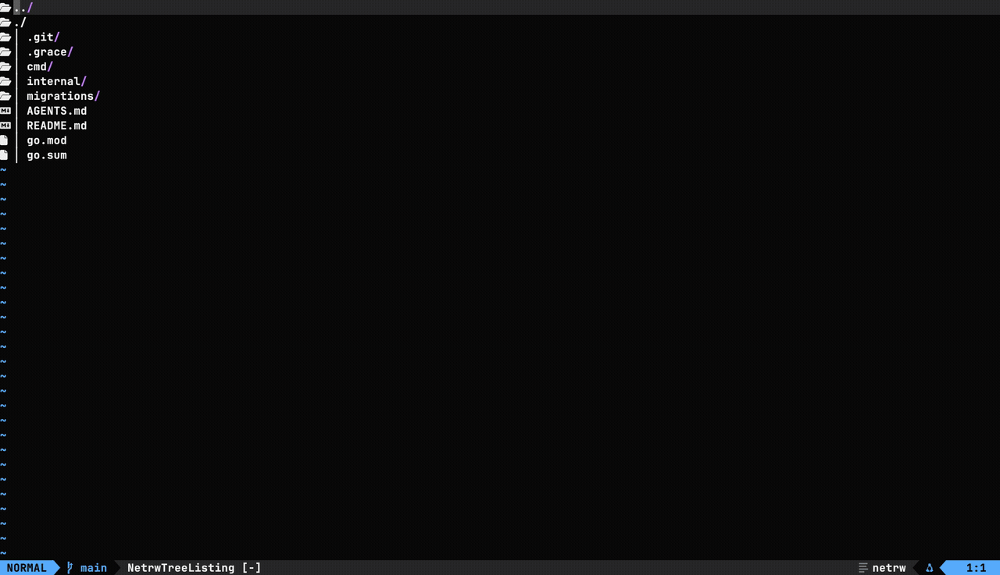

<h1 align="center">BetterVim</h1>

A Neovim config aimed at providing a better Neovim experience.



## ✨ Features

- 💾 Keeps track of open files and remembers your cursor position in each file and in netrw, so you can pick up where you left off in a project.
- ⚙️ Sticks to Neovim and plugin defaults where possible.

## 🛠️ Requirements

- Neovim 0.12+
- A Nerd Font

## 🚀 Installation

```sh
cd ~/.config/nvim
git clone https://github.com/danielsavinoff/better-vim .
rm -r .git
```
